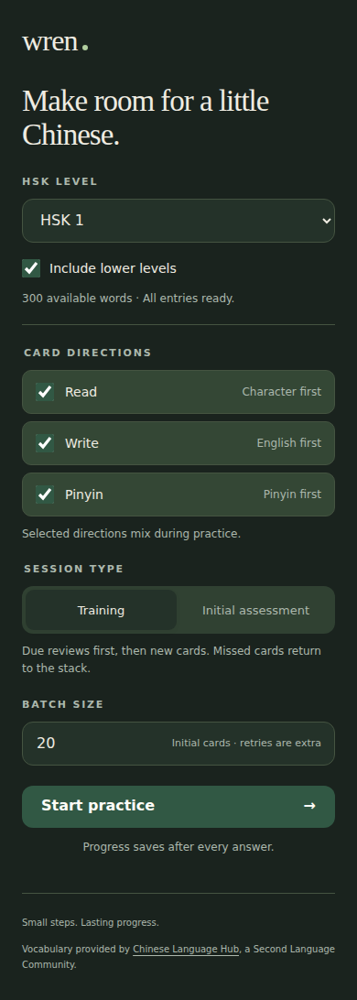
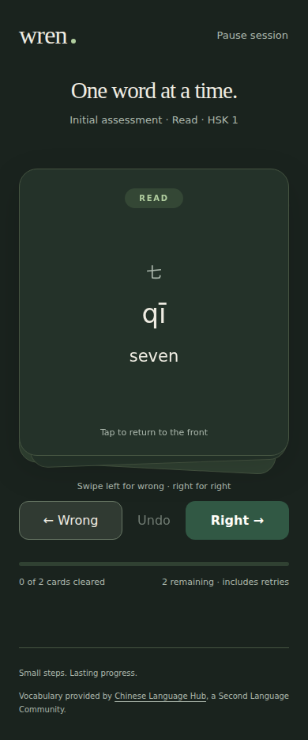

# Wren

A little Chinese, daily. A single-user, spaced-repetition vocabulary trainer for
HSK preparation, with an embedded web interface and SQLite-backed progress.

| Session setup | Card review |
| --- | --- |
|  |  |

## Build and run

Use the Go version declared in `go.mod`; no Node installation, frontend build,
CGO, or database server is required.

```sh
./build.sh gen test vet lint build
./bin/wren
```

Open <http://127.0.0.1:8080>. The default database is
`$XDG_DATA_HOME/wren/wren.db`, falling back to
`~/.local/share/wren/wren.db`.

```sh
./bin/wren --addr 127.0.0.1:9090 --db /path/to/wren.db
./build.sh install
wren --help
```

The executable contains all web assets, vocabulary JSON, and schema migrations.
It works outside the source directory. Rebuild after changing assets or JSON;
there is no disk-backed asset mode or external asset request.

To use a phone on a trusted network, explicitly bind to a reachable interface,
for example `--addr 0.0.0.0:8080`, and open the host's LAN address on the phone.
**There is no authentication: do not expose Wren to the public Internet or an
untrusted network.** HTTP must remain reachable while reviewing; this is not an
offline browser application.

## Practice

Choose an HSK group, optional lower levels, a batch size from 1 to 100, and any
combination of directions:

| Direction | Front | Back |
| --- | --- | --- |
| Read | Chinese | Pinyin and English |
| Write | English | Chinese and pinyin |
| Pinyin | Pinyin | Chinese and English |

Pinyin is a text-only exercise, not listening comprehension. Answers are
self-graded, not exact-text matched.

- **Initial assessment** draws unassessed cards. Known cards get their first
  verification after seven days; unknown cards enter short-interval learning.
  Each word/direction has separate progress.
- **Training** prioritizes due reviews, then introduces new cards. It does not
  bring future-due cards forward to fill a batch.
- Tap/click the card or press **Space** to flip repeatedly. Swipe **left/right**,
  press **Left/Right Arrow**, or use **Wrong/Right** buttons to grade.
- Wrong moves the card to the bottom. Right clears it from this session. Retries
  can extend a batch beyond its initial size.
- **Undo** (also **Z**) restores the previous answer, schedule, and queue order.
  A final answer can be undone from the completion screen.
- Pause to return to setup; resume after reloading or restarting. There is one
  unfinished session at a time. Explicitly end it to choose a different setup;
  previously saved learning progress is retained.

The interface follows the OS light/dark setting and reduced-motion preference.
Settings stack vertically on mobile. A failed save displays a retry or reload
action; a lost response can be retried without grading twice.

Scheduling uses FSRS-6 through `go-fsrs/v4`. Wrong maps to Again and Right to Good.
One-minute learning/relearning steps let a failed card return in the current
stack without forcing a timed wait. A correct retry graduates it for this
session; the prior failure still affects its next due date.

## Vocabulary and updates

Vocabulary lists identify themselves as **HSK 3.0, 2025 edition**, provided by
[Chinese Language Hub](https://chineselanguagehub.com), a Second Language
Community. Publisher metadata records the vocabulary source, not necessarily
the origin of separately enriched translations or pronunciation.
The app trains vocabulary rather than providing full exam simulation or
guaranteeing exact coverage of a particular test.

The HSK level comes from each JSON file's `label`. HSK 7-9 remains one combined
group. The lists are incremental; enabling lower levels combines their terms.

On startup, Wren validates the embedded snapshot and syncs files whose SHA-256
hash changed. Vocabulary sync is separate from transactional schema migrations.
Corrections and source moves retain stable term IDs and schedules. Removed terms
are deactivated, not deleted with their history. Unavailable queue entries are
removed with a notice; undo is disabled for affected pre-sync history.

Incomplete terms remain stored but cannot be practiced without Chinese, pinyin,
and English. Setup shows available and excluded counts. The supplied snapshot
has 11,495 terms; 5,186 lack required enrichment, mostly in HSK 7-9.

## Backup and restore

Stop Wren cleanly with Ctrl-C before copying its database file. Closing the last
SQLite connection normally checkpoints and removes the WAL sidecars; confirm no
other Wren process or database connection remains open before copying.
For a live backup, use a SQLite-aware backup tool instead of copying just the
main file, because recent changes may be in its `-wal` file.

To restore, stop Wren, restore the backup at the configured database path, then
restart. Startup applies newer schema migrations and embedded vocabulary syncs.
An older executable refuses a database with a newer schema.

## Development

Use `./build.sh help` for short flags and word aliases. Developer tools are
pinned in `go.mod`. Tests use isolated temporary databases and do not touch the
normal application database.

- [Engineering guidelines](docs/architecture/guidelines.md)
- [v1 design, implementation details, and mockups](docs/plans/0001/README.md)
