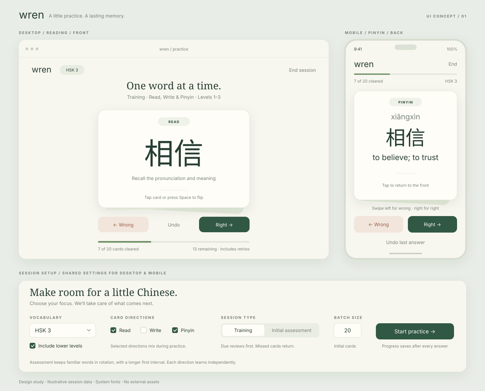
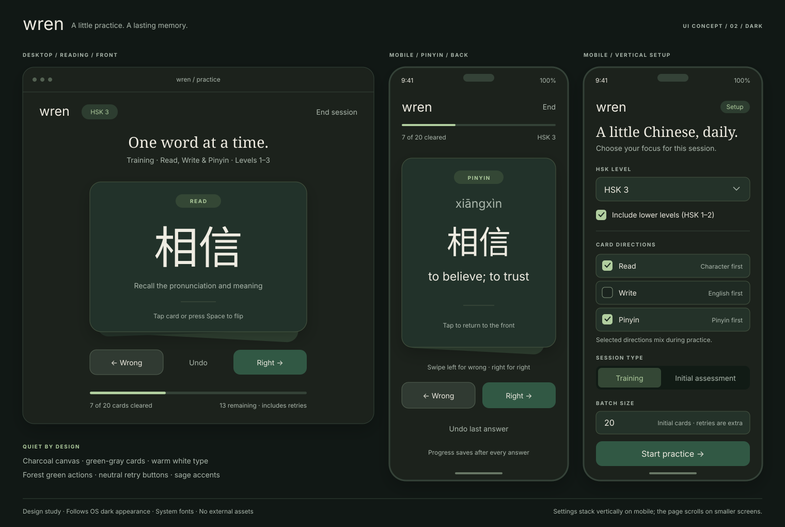

# v1 design and implementation

Status: design agreed in principle; implementation not started.

Date: 2026-10-19.

## Goal and scope

Wren is a single-user, spaced-repetition vocabulary trainer for HSK preparation.
It should help identify gaps in existing vocabulary and retain words through
short, repeatable sessions on mobile and desktop.

The v1 deliverable is one Go executable containing the web assets and vocabulary.
SQLite holds durable learning progress. There is no Node toolchain, external
asset service, account system, or runtime dependency on the source checkout.

V1 trains vocabulary, not the whole HSK examination. Pinyin-based recall is a
deliberate text-only substitute for audio in this release, not actual listening
comprehension. Audio, speech recognition, handwriting recognition, sentence
composition, timed mock examinations, and claims of exact syllabus coverage are
out of scope.

## Approved visual direction

### Light appearance



[Open the light mockup](wren-ui-mockup.svg).

Use warm cream backgrounds, forest-green primary actions, subtle card depth,
generous spacing, and prominent Chinese typography.

The horizontal settings strip in this first mockup is superseded by the vertical
mobile setup shown below. The light mockup remains the reference for the light
palette and card appearance.

### Dark appearance and vertical setup



[Open the dark mockup](wren-ui-dark-mockup.svg).

Use charcoal backgrounds, green-gray cards, warm off-white text, and sage accents.
Right and Start buttons retain the light-mode forest green (`#315844`).
Wrong buttons are neutral gray-green, not red.

Both SVGs are static design references, not functional screens; their displayed
session counts are illustrative.

## Learning model

### Card directions

| Direction | Front | Back |
| --- | --- | --- |
| Read | Simplified Chinese character or word | Pinyin and English |
| Write | English | Simplified Chinese character or word and pinyin |
| Pinyin | Pinyin | Simplified Chinese character or word and English |

Directions are independent checkboxes, not a mutually exclusive selector.
Require at least one. Selected directions mix within a session.

Each term/direction pair is a separate card with its own assessment and scheduler
state. Recognizing a word must not mark its writing or pinyin cards as mastered.
Use the label **Pinyin**, not Listen, while there is no audio.

Answers are self-graded. English meanings and pinyin can identify multiple valid
words; v1 must not implement brittle exact-answer matching. Writing means trying
to produce the word before revealing it, mentally or on paper; an answer-entry
field and automated grading are not required.

Traditional forms remain in storage for possible future use, but a script
selector is not part of v1.

### Session settings

Persist these defaults server-side:

| Setting | Meaning |
| --- | --- |
| HSK level | One of 1, 2, 3, 4, 5, 6, or the combined 7-9 group |
| Include lower levels | Selected level alone, or that level plus all lower groups |
| Batch size | Number of distinct cards initially drawn, not number of attempts |
| Card directions | Any nonempty combination of Read, Write, and Pinyin |
| Session type | Initial assessment or Training |

The source lists are not cumulative: selecting HSK 3 with lower levels includes
the entries from HSK 1, 2, and 3. Do not split HSK 7-9 into individual levels:
the source does not provide that distinction.

On mobile, stack settings vertically: level and lower-level checkbox, directions,
session type, batch size, and a full-width Start button. Let the page scroll on
short screens. Desktop may use a compact two-column form.

Snapshot the settings when starting a session; changing defaults must not mutate
an ongoing session.

### Initial assessment

Assessment draws cards that have not yet been assessed, in resumable batches.
It uses the same front/back and right/wrong controls as training.

- A first Right means the learner considers this card known. Give it a
  significantly longer initial interval than an unknown card.
- A first Wrong records an unknown card and introduces it into short-interval
  learning. Move it to the bottom of the current stack.
- A retry does not overwrite the original assessment result. Subsequent correct
  recall is new evidence, not a retroactive claim that the card was already known.
- Already assessed cards are not reassessed or reset when another assessment
  session starts.
- Known cards remain in spaced repetition. A later lapse brings their review
  closer again.

Self-assessment is not proof of long-term retention. Record the assessment
separately from ordinary FSRS recall events. The exact initialization policy and
first-review intervals must be decided explicitly before implementing scheduling;
do not fabricate past review history.

### Training and scheduling

Use `github.com/open-spaced-repetition/go-fsrs/v4`, initially pinned to a reviewed
release. The researched v4.0.0 release implements FSRS-6 and requires Go 1.26;
the current project declares Go 1.27.2.

Map Wrong to FSRS **Again** and Right to **Good**. Persist every actual training
attempt, including same-session retries, with its real timestamp. Keep FSRS
configuration and algorithm/package version identifiable in review history.

FSRS owns long-term due dates and memory state. Wren owns session membership and
queue order. A failure must stay in the current queue even if its scheduler due
time is later. A correct retry clears the card from this session, but the earlier
lapse still influences its next review.

Configure and verify the scheduler's learning steps for this interaction. Do not
assume every Good on a new or relearning card immediately graduates it to a
multi-day interval; the queue can be complete while a near-term review remains
scheduled.

Due reviews take priority. Do not silently pull future-due cards forward just to
fill a batch. Show an honest empty or smaller queue when appropriate. The policy
for introducing previously unassessed/new cards into Training remains a
pre-implementation decision below.

Reference: [go-fsrs](https://github.com/open-spaced-repetition/go-fsrs).

## Session lifecycle and interactions

1. Choose settings and start a batch, or resume an unfinished batch.
2. Show the front of the top card with its direction clearly labeled.
3. Tap/click or press Space to flip. Allow repeated front/back flips.
4. Swipe left or press Left Arrow for Wrong; swipe right or press Right Arrow
   for Right. Visible Wrong and Right buttons perform exactly the same actions.
5. Wrong records the attempt and moves the card to the bottom, front facing.
6. Right records the attempt and removes the card from the active stack.
7. Finish when the stack is empty, or leave early with progress preserved.

Batch size counts the initial term/direction cards. Retries add attempts, not new
batch members: a 20-card batch can require more than 20 answers.

Display cards cleared and cards remaining rather than a misleading attempt-based
completion percentage. Provide Undo last answer and durable resume after a reload
or process restart.

Avoid consecutive directions of the same word because one reveals the other's
answer. Carry the last shown word across batch boundaries. Apply this whenever
other eligible words are available; do not deadlock a queue containing only one
word. Repeated failures must still return to the bottom as requested.

When only one card remains, Wrong returns that card to the same position.
Do not force the user to keep going indefinitely: leaving the session saves it.

### Animations and input

- Flip: a short 3D front/back rotation with the hidden face concealed.
- Swipe: follow horizontal pointer movement, then tilt and dismiss when committed.
- Wrong: dismiss left, then shrink and reinsert behind the stack.
- Right: dismiss right and lift the next card into place.
- Canceled drag: settle back without grading.
- Sole remaining wrong card: settle/reset rather than fake a stack behind it.

Target roughly 200-350 ms transitions. Buttons and keyboard shortcuts use the
same transitions as touch. Distinguish a tap from a drag so a swipe cannot also
flip the card. Preserve vertical scrolling on mobile setup and ordinary browser
behavior outside the card.

Use Pointer Events and CSS transforms, not an animation framework. Disable
duplicate grading while a mutation is pending. Animate while saving, but do not
allow the next answer until persistence succeeds. On failure, restore the
confirmed state and show an explicit retryable error.

Honor `prefers-reduced-motion` with minimal fades or immediate transitions.
Provide accessible control names, keyboard focus indicators, usable touch
targets, and text labels rather than relying on color or gesture alone.
Do not intercept shortcuts while a form control is being edited.

## Appearance and web architecture

Use semantic HTML, custom CSS, and native JavaScript modules, served with
`net/http`. No React, HTMX, Alpine, npm, bundler, transpiler, or CDN is needed.
Use a system Chinese font stack rather than bundling a large CJK font in v1.

Define shared CSS tokens for surfaces, text, borders, accents, and action colors.
Follow `prefers-color-scheme` automatically, including live OS changes; declare
`color-scheme` so native controls fit the theme. There is no manual theme toggle
requirement. Verify readable contrast in both appearances.

Go remains authoritative for session state and scheduling. JavaScript handles
the visible face, pointer interaction, animations, and HTTP requests. The client
must not compute independent FSRS state or persist progress only in localStorage.

Keep every web asset under `web/` and embed that directory. Rebuild the binary for
asset changes in both development and production. Do not add a disk-backed asset
mode or development asset server.

### Proposed source layout

```text
main.go                    # Startup, configuration, embedded filesystem roots
go.mod
data/                      # Embedded, version-controlled vocabulary JSON
web/
    index.html
    css/
        app.css
    js/
        app.js
        cards.js
    images/                # Only if needed; do not add placeholder assets
internal/
    store/                 # SQLite access, migrations, transactions
        migrations/
    vocabulary/            # JSON validation, level parsing, hash-based sync
    study/                 # FSRS integration and session queue operations
    server/                # HTTP handlers and embedded asset serving
docs/plans/0001/
    README.md
    wren-ui-mockup.svg
    wren-ui-dark-mockup.svg
```

The layout is a starting point, not a requirement to create empty packages.
Embed SQL migrations alongside the store package. Embed `web/` and `data/`
from a parent package so Go embed paths never need `..`.

## Persistence

Use `database/sql` with `modernc.org/sqlite`: a local database file, no CGO and
no separate database server. No users table is needed.

The schema below is logical design, not final migration SQL. Use foreign keys,
uniqueness and check constraints, and explicit nullable fields. Represent stored
timestamps consistently in UTC with enough precision for same-session events.
Keep the distinction between an absent last review and an actual timestamp.

### `terms`

| Field | Purpose |
| --- | --- |
| `id` | Stable primary key |
| `simplified` | Unique import identity for the current dataset |
| `traditional`, `pinyin`, `english` | Source vocabulary fields |
| `hsk_level_min`, `hsk_level_max` | Parsed level range |
| `source_path` | Owning embedded JSON file |
| `active` | Present in the current vocabulary snapshot |

Do not change term IDs when correcting translations, pronunciation, or level.
Use simplified text as the current natural key because the supplied data has no
duplicates; adding distinct senses/pronunciations later requires explicit source
IDs and an identity migration, not silent merging.

### `cards`

One row per `(term_id, direction)`, enforced by a unique constraint.

Store `id`, `term_id`, `direction`, `assessed_at`, and the initial assessment
result, plus the actual go-fsrs card fields:

| Field | Purpose |
| --- | --- |
| `due` | Next scheduled review |
| `stability`, `difficulty` | FSRS memory model |
| `scheduled_days` | Scheduled interval |
| `reps`, `lapses` | Review and lapse counters |
| `state` | New, Learning, Review, or Relearning |
| `last_review` | Last actual review, absent for an untouched card |
| `remaining_steps` | Learning/relearning step state |

Use queryable columns rather than one JSON blob. Add a due-selection index
starting with direction and due time, and verify it against the final query.
Eligibility also depends on term activity, field completeness, level, and
assessment status.

### `review_events`

Record `id`, `card_id`, `session_id`, actual occurrence time, event kind,
assessment response or FSRS rating as appropriate, and `undone_at`.

Store before/after card snapshots and sufficient before/after queue/session
state for Undo last answer. JSON is appropriate for these snapshots because
they are restored rather than used to select due cards. Include scheduler
configuration/version provenance.

Do not pass assessment events off as ordinary recall events when deriving FSRS
review history. Undone events stay visible in the audit history but do not
contribute to the effective history.

### `sessions`

Store the settings snapshot, initial card count, start and completion times,
lifecycle status, and a mutation revision. Preserve enough information to resume
the last shown word and prevent stale requests from another tab.

Proposed v1 simplification: one unfinished session at a time; offer resume rather
than implicitly replacing it. Confirm that policy before implementing.

### `session_cards`

Store session ID, card ID, queue position, and cleared status. Enforce one
membership per card per session. A wrong answer moves the existing row to the
tail; it must not insert duplicate memberships.

Positions may be monotonically increasing integers; gaps are harmless. Queries
sort remaining rows by position. Undo restores the previous ordering and, if
necessary, reopens a just-completed session.

### `settings`

A singleton row holding the defaults for level selection, lower-level inclusion,
batch size, directions, and session type. Validate both browser input and API
requests; disabled controls alone are not validation.

### `data_imports`

Key each row by embedded source path. Store its SHA-256 hash and successful
import timestamp; retain presence status if needed to account for removed files.
This table tracks vocabulary sync, not schema version.

### `schema_migrations`

Record successfully applied ordered schema migrations. Use embedded SQL and a
small versioned migration mechanism; do not conflate this with JSON hashes.

### Transactions and durability

An answer transaction updates the FSRS/assessment state, appends the event,
updates queue membership/order, and updates session revision/completion together.
Undo is similarly atomic. Never acknowledge success before commit.

Use an expected session revision and a unique client mutation ID (persisted with
the event) to reject stale answers and make retries idempotent. A lost response
must not turn a single click into two reviews. Apply the same principle to undo
and other state-changing operations.

Enable foreign keys on every connection, set a busy timeout, and use WAL mode.
A single database connection is a reasonable initial way to serialize this
single-user app's writes; do not add a connection pool tuning subsystem.

Log actionable database failures and return explicit errors. Document backups
using a SQLite-aware backup or a clean shutdown/checkpoint; copying only the live
main file can miss WAL contents.

## Embedded vocabulary sync

Schema migration changes database structure. Vocabulary sync reconciles the
embedded source snapshot with existing rows and must preserve learning history.

### Current source data

| Group | Terms | Entries missing one or more expected vocabulary fields |
| --- | ---: | ---: |
| HSK 1 | 300 | 0 |
| HSK 2 | 197 | 0 |
| HSK 3 | 491 | 0 |
| HSK 4 | 990 | 1 |
| HSK 5 | 1,579 | 0 |
| HSK 6 | 1,777 | 0 |
| HSK 7-9 | 6,161 | 5,185 |
| Total | 11,495 | 5,186 |

These counts describe the files inspected on 2026-10-19, not hardcoded
application limits. Store incomplete entries without inventing missing content.
Since every v1 direction needs simplified text, pinyin, and English across its
two faces, omit cards missing any of those fields from assessment and training.
A missing traditional form alone must not exclude a simplified-script card.
Report skipped entries and show useful availability information in setup.

### Level parsing

Parse the JSON **`label`** as authoritative, not the filename or numeric `level`
property. Validate the entire label against the supported forms.

| Label | Stored range |
| --- | --- |
| `HSK 3` | 3, 3 |
| `HSK 7-9` | 7, 9 |

Reject malformed or unsupported labels explicitly. Preserve the combined range
in selection and display.

### Startup sequence

1. Open SQLite, configure it, and apply pending schema migrations.
2. Enumerate the embedded JSON files and compute SHA-256 over each file's bytes.
3. Validate the source snapshot, including labels, unique term identities, JSON
   types, and declared counts. Detect duplicates across files before mutation.
4. Compare paths and hashes with `data_imports`.
5. Within one vocabulary transaction, upsert new/changed source terms, create
   missing direction cards, and update ownership/level/content without resetting
   existing cards or history.
6. Deactivate terms removed from changed files or removed files. Account for moves
   between files before deactivation so a moved word retains its identity.
7. Reconcile unavailable cards in unfinished sessions explicitly; do not leave
   broken queue references or silently display missing content.
8. Update successful source hashes/presence records and commit.
9. Start serving only after initialization succeeds.

Do not delete-and-reinsert vocabulary or cascade-delete its learning history.
Reintroduced terms should reactivate the existing identity and preserve progress.
An unchanged snapshot must not rewrite vocabulary or schedule state.

Formatting-only JSON changes may cause a harmless upsert; raw-byte hashing is
sufficient. On validation/import failure, roll back the vocabulary transaction,
leave its previous hashes intact, and exit with a clear error rather than
serving a partially updated dataset. Missing enrichment fields are reported
content limitations, not structural import failures.

## HTTP boundary

Use a small JSON API; final route names may change:

| Operation | Suggested route |
| --- | --- |
| Read/save defaults and available level counts | `GET /api/settings`, `PUT /api/settings` |
| Start a session | `POST /api/sessions` |
| Find the resumable session | `GET /api/sessions/current` |
| Read confirmed queue/current card | `GET /api/sessions/{id}` |
| Grade current card | `POST /api/sessions/{id}/answers` |
| Undo last answer | `POST /api/sessions/{id}/undo` |
| Leave/pause a session | `POST /api/sessions/{id}/pause` |

Return confirmed session state after mutations. Include revision and mutation
identity where needed. Validate that the answered card is the current queue head.
Use consistent structured errors and distinguish invalid requests, stale session
state, and storage failures.

Render vocabulary as text, not injected HTML. Keep mutations on non-GET routes
and reject cross-origin mutations. Default to local binding for an unauthenticated
single-user application; expose it to a trusted network only deliberately.
Accounts, public hosting, and authentication are not part of this design.

## Implementation sequence

### 1. Application shell and persistence foundation

- Add the SQLite and FSRS dependencies, pinned through Go modules.
- Establish startup/configuration for listen address and database path.
- Embed assets, vocabulary, and SQL migrations from suitable package roots.
- Add the initial schema, database initialization, and clean shutdown.
- Verify the binary can start outside the repository working directory.

### 2. Vocabulary ingestion

- Implement strict JSON and label parsing, field eligibility checks, and hashing.
- Implement transactional first import, changed-source upserts, file removal,
  term reactivation, and source moves.
- Expose available level/group counts and incomplete-content reporting.
- Preserve IDs and scheduling through repeated syncs.

### 3. Scheduler and assessment

- Resolve the assessment initialization and new-card policies below.
- Wrap go-fsrs with explicit state/time conversion and Wrong/Right mapping.
- Implement independent directions, assessment recording, and learning retries.
- Preserve review provenance and injectable time for deterministic tests.

### 4. Sessions, history, and HTTP API

- Implement initial selection, mixing, persistent queue ordering, and resume.
- Add atomic answers, idempotency, stale-state protection, undo, and pause.
- Verify same-word spacing where alternatives exist, including batch boundaries.
- Return explicit empty, complete, stale, and failed states.

### 5. Responsive interface

- Build vertical mobile setup and adaptable desktop layout.
- Implement the card stack, repeatable flips, gesture grading, buttons, shortcuts,
  progress, retry errors, undo, and session completion/resume.
- Match the approved light/dark designs and follow OS appearance changes.
- Add flip/swipe/reinsertion transitions and reduced-motion behavior.

### 6. Finish and document

- Exercise startup, vocabulary upgrades, sessions, undo, and restart end to end.
- Check mobile portrait, narrow/short viewports, and desktop keyboard usage.
- Document running, rebuilding embedded assets/data, database location, local
  network exposure, and safe backup/restore.
- Keep implementation changes scoped to v1; no speculative framework or tooling.

## Validation and acceptance

Use Go's existing test tooling and temporary SQLite databases. Prefer focused
behavior tests; use the real SQLite driver rather than mocking transactional
behavior. Use deterministic timestamps and scheduler settings where appropriate.

| Area | Required checks |
| --- | --- |
| Parsing | Single/range labels; malformed label rejection; incomplete fields; duplicate identities; invalid counts/types |
| Sync | Initial import; unchanged no-op; edited content; preserved IDs/history; file/term removal; moves/reactivation; failed transaction leaves hashes unchanged |
| Scheduling | Independent directions; Again/Good; known versus unknown initialization; lapse then same-session success; actual elapsed time |
| Selection | Exact/lower-level scope; combined 7-9; direction mixing; due priority; no early future-card fill; same-word spacing |
| Queue | Wrong moves to tail; Right clears; retries exceed initial batch count; last-card retry; honest progress |
| Persistence | Reload/restart resume; atomic answer; undo restores schedule and order; final-answer undo; duplicate retry; stale second-tab request |
| HTTP | Validation and status codes; explicit database errors; cross-origin mutation rejection; no mutation through GET |
| Embedded binary | Assets/data work with a different working directory and without source directories present |

Manually verify the browser experience without introducing a Node build or
mandatory browser automation dependency: tap versus drag, repeated flips,
canceled swipes, all input methods, vertical scrolling, save failure recovery,
light/dark OS changes, reduced motion, focus visibility, and readable contrast.

Before completion, run the applicable Go tests, `go vet ./...`, and a build.
Confirm no runtime external asset requests or frontend build step is required.

## Decisions to close before the relevant implementation step

These are not blockers to documenting the agreed design, but must not become
silent scheduler or UX assumptions:

- **Assessment initialization:** choose and test the longer first interval for
  known cards and the memory-state initialization compatible with FSRS. Treat
  unknown-card retries as real learning without overwriting the initial result.
- **New cards in Training:** decide whether Training introduces unassessed cards
  after due reviews, or whether initial assessment is required first.
- **Learning steps and retry timing:** select FSRS learning steps consistent with
  immediate queue-to-bottom retries, including short sessions and one-card queues.
- **Defaults and bounds:** choose default level, enabled directions, batch size,
  and valid batch-size limits. Mockup values such as 20 are examples.
- **Session policy:** confirm one unfinished session at a time and the behavior
  when the learner wants a different setup before finishing it.
- **HSK alignment:** identify the source syllabus/version before claiming exact
  examination vocabulary coverage; retain honest text-only vocabulary scope.
